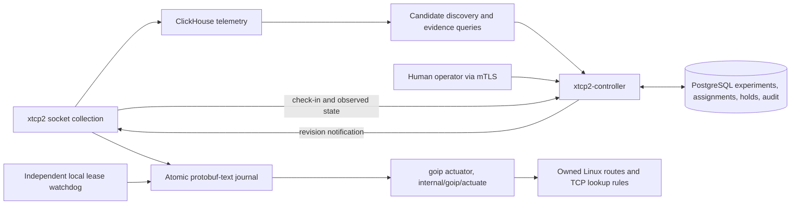

# Reviewed TCP route treatments

xtcp2 can now opt into a separate controller that proposes TCP route treatments,
rolls them out after human review, and withdraws failed trials. Ordinary xtcp2
collection and the goip CLI retain their existing behavior. The agent runs
either inside xtcp2 (`-treatmentConfig`, a build with the `treatment` tag) or
as the standalone `xtcp2-treatment-agent` beside an xtcp2 that only reads its
journal (`-treatmentAttribution`); see [Agent deployment](#agent-deployment).
Route application requires `enable_apply: true` in the agent configuration in
either arrangement.

## Components and authority



The implementation lives under [pkg/treatment](../pkg/treatment), split by
audience so that each binary links only the half of the contract it needs, with
a typed [protobuf contract](../proto/xtcp_treatment/v1/) (`xtcp_treatment.v1`: `treatment.proto` types, `agent.proto`, `operator.proto`) and a separate
[journal file format](../proto/xtcp_treatment_journal/v1/journal.proto) (`xtcp_treatment_journal.v1`) that the host side reads and writes without the RPC stubs:

| Package | Used by | Contents |
| --- | --- | --- |
| `pkg/treatment` | everyone | the domain model (`Treatment`, `Experiment`, `Evidence`, `DesiredState`, enums), limits and validators; proto-free |
| `pkg/treatment/wire` | gRPC boundary | domain ↔ generated proto conversion; `Parse*` fails closed on unknown enums and invalid timestamps |
| `pkg/treatment/identity` | agent, controller, tools | SPIFFE URI identity, mTLS configuration, gRPC peer resolution, `Policy` interceptors that resolve the caller once per call |
| `pkg/treatment/reconcile` | agent, watchdog | intent journal (`State`, `Record`, the `xtcp_treatment_journal.v1` file format), reconciler, `Backend` interface, `Mode` (full or expiry-only); domain types only, no RPC proto, no gRPC |
| `pkg/treatment/local` | agent, watchdog, `treatmentctl` | the shared `controller-agent.json` config and the goip-backed reconciler built from it; no TLS, no controller |
| `internal/goip/actuate` | `local` | the route actuator: owned table, rule priority and protocol, baseline copy with TCP metrics, ownership and readback checks; requests come from `xtcpnl`'s typed `RouteWrite` and `RuleWrite` builders and reach the kernel only through `goip.NetlinkSource.ApplyRouteControl`, the one live-write path in goip |
| `pkg/treatment/attribution` | `xtcp2`, agent | the exposure index built from a journal snapshot and the hot-path telemetry stamp; the same code serves the embedded agent and a telemetry-only daemon |
| `pkg/treatment/experiment` | controller | evaluation statistics, cohort allocation, phase advancement, state machine; pure functions over domain types |
| `pkg/treatment/agent` | `xtcp2`, agent binary | check-in loop, watch stream, capabilities, over `local` and `attribution`; a library with two front ends |
| `pkg/treatment/controller` | `xtcp2-controller` | gRPC handlers, maintenance and discovery over the store and evidence ports |
| `pkg/treatment/controller/store` | controller | repository interfaces (`Agents`, `Experiments`, `Evidence`, `Holds`, `Audit`, `Metrics`) and `Store.Tx` |
| `pkg/treatment/controller/evidence` | controller | warehouse ports: `Source` (measure a `Window`), `CandidateSource` (scan a location), `Warehouse` (both); `WindowFor` is the controller's window policy |
| `pkg/treatment/controller/evidence/clickhouse` | `xtcp2-controller` | the one warehouse adapter: `analysis.sql` and `discovery.sql` over the ClickHouse HTTP interface, parameterized, 8 MiB response cap |
| `pkg/treatment/controller/store/postgres` | `xtcp2-controller` | the only package with SQL: relational schema, pgx through `database/sql`, advisory-lock transactions |
| `pkg/treatment/controller/store/memory` | handler tests | map-backed store that passes the same conformance suite (`store/storetest`) |

The generated protobuf types are wire-only. The controller works on the Go
domain types and converts at the gRPC boundary; PostgreSQL holds a relational
schema (one column per field, `cidr` destinations, evidence stored once and
referenced by ID), so a proto field rename can never break SQL or an index. The
only JSON column is the append-only audit payload.

`pkg/treatment/boundaries_test.go` enforces the layering: `xtcp2` and the agent
never link the controller, a SQL driver or the ClickHouse client; the domain
and experiment packages never import the proto or gRPC; the reconcile package
never imports the RPC proto or gRPC; the watchdog never links TLS identity, the
agent or the RPC proto; SQL lives only in the postgres store; the controller
never links the host-side reconcile, local or attribution packages or goip.
The binaries are:

| Binary | Responsibility |
| --- | --- |
| `xtcp2-controller` | PostgreSQL state, discovery, analysis, review gates, leases, gRPC, status and metrics |
| `xtcp2-controllerctl` | Authenticated `propose`, `analyze`, `review`, `control`, and `inspect` requests |
| `xtcp2` | Telemetry attribution from the journal (always); the embedded agent with `-treatmentConfig` when built with the `treatment` tag |
| `xtcp2-treatment-agent` | The same agent as a standalone process: controller connection, journal and kernel reconciliation; pairs with `-treatmentAttribution` |
| `xtcp2-treatmentctl` | Local status, suspension, resume, reconciliation, independent watchdog |

ClickHouse is an evidence source; PostgreSQL is the authority for desired state.
Every control mutation commits the experiment, affected assignments and audit
events in one transaction. A transaction-level advisory lock fences replicas.
Request IDs make operator retries idempotent; reusing an ID with a different
request is rejected. Reviews also require the expected experiment revision.
Agents consume complete revisioned snapshots, so missed notifications are safe.
A shared two-second notification scan coalesces updates; jittered check-ins run
approximately every thirty seconds. No message broker is required.

The scan is incremental. Every desired-state write stamps the agent row with
the database clock (`clock_timestamp()`, taken after the advisory lock, so
stamps commit in lock order), and each scan reads only rows stamped at or
after the previous scan's newest stamp less a one-second margin, through the
`desired_updated_at` index. The first scan after a restart reads every row so
late subscribers learn the current revision; the hub drops repeated revisions.
A check-in writes one agent row: the record and algorithm rows are rewritten
only when a digest of the report's content changes, so a steady fleet costs
one single-row update per heartbeat. Maintenance and candidate discovery run
under a session-level advisory lease (`pg_try_advisory_lock` on a dedicated
connection) that one replica holds for the pass; the others log that they are
skipping. The lease is about cost, not correctness: every write is still fenced
by the transaction-level mutation lock.

## Trust boundaries and threat model

The control plane has four kinds of principal. What each can do is decided by
the certificate it presents or the host it runs on, never by a request field.

| Principal | Credential | Can | Cannot |
| --- | --- | --- | --- |
| Operator | mTLS certificate with `spiffe://xtcp/operator/<id>` | propose, analyze, review, control, inspect; every action is audited under that ID | act as an agent; reuse a request ID with a different body |
| Agent | mTLS certificate with `spiffe://xtcp/agent/<location>/<id>` | check in, fetch and watch its own desired state | speak for another agent, call an operator RPC, move to another location, or receive a route no operator reviewed |
| Controller replica | PostgreSQL and ClickHouse credentials | everything above on the operators' behalf | nothing is withheld; replicas are peers and fully trusted |
| Host root | the journal directory and the netlink socket | run the agent, the watchdog and `xtcp2-treatmentctl`; suspend locally | change another host; the actuator only touches its own table, rule priority and route protocol |

The route itself is defended in depth: the controller cannot install anything
without an operator review, the actuator refuses routes it does not own on
readback, trials carry leases the watchdog enforces without the controller, and
a local suspension or a withdrawn desired state removes routes without any
network dependency.

Evidence is the weakest boundary and the one to understand. Every telemetry
record carries the agent ID, location, boot ID, collection nonce and exposure
fields that the host itself stamped, and reaches ClickHouse through the
existing telemetry pipeline (Kafka or NSQ, then ClickHouse), which carries no
per-host authentication. The controller therefore trusts the warehouse to tell
it which host produced a record. A compromised or misconfigured host can emit
records that name another enrolled agent in its location and shift that host's
measured goodput, retransmission ratio or RTT. It cannot make the controller
issue a route (that needs an operator), but it can push a running trial into an
automatic rollback by faking harm, or mask real harm on a host it impersonates.

What limits that today: evidence queries filter by the experiment's location
and the frozen cohort's agent IDs, so records naming hosts outside the cohort
are never read; per-host sample minimums and the two-minute freshness window
bound how little data can swing a verdict; every expansion and completion is a
human review of typed evidence, and completed experiments only ever request
review on drift; evidence rows are immutable once stored, keyed by ID and
digest, and every decision is in the audit log with the operator's identity.
What is not done: binding a telemetry record to the boot ID and collection
nonce the same agent reported at check-in, which would let the warehouse
query reject records a host did not plausibly produce. That is the next
hardening step for this boundary and is tracked in the status document.

Inside the controller, the advisory mutation lock and the housekeeping lease
order work and bound cost; neither is an authorization mechanism. Request IDs
make an operator's own retries idempotent; they are no defence against a
principal holding an operator certificate, who is an operator.

## Names and surfaces

One feature name, `treatment`, is used for everything the host side and the
contract share: the Go packages under `pkg/treatment`, the proto packages
`xtcp_treatment.v1` and `xtcp_treatment_journal.v1`, the journal, the
`treatment` build tag, the daemon flags `-treatmentConfig` and
`-treatmentAttribution`, and the NixOS options under
`services.xtcp2.treatments`. `controller` names the server role, so the server
binary is `xtcp2-controller` and its operator client is `xtcp2-controllerctl`.
`route` is reserved for the kernel object the actuator manages and appears in
`internal/goip/actuate` and in prose, not in a binary or package name.

`xtcp2-treatmentctl` stays separate from the daemon's `xtcp2ctl` on purpose:
it works on the journal directory as root, has no network path and must keep
working, as the watchdog, when the daemon and the controller are both down.
Folding it into a daemon-side CLI would make the independent withdrawal path
depend on the process it is meant to outlive.

There are three configuration surfaces, one per audience. Operators configure
`xtcp2-controller` with flags, a DSN file and an optional discovery-template
JSON file, all read at start. Hosts share one `controller-agent.json` between
the agent, the watchdog and `xtcp2-treatmentctl`, so all three agree on the
journal directory and route table. Operator requests are the RPC messages
themselves in protobuf text, which `xtcp2-controllerctl -file` sends without
a schema of its own.

## Supported routes and TCP semantics

The first actuator supports IPv4 `/32` and IPv6 `/128` destinations in the host
network namespace, with ordinary local/main/default routing and a unique simple
unicast baseline route. It refuses policy-routing configurations, VRFs, ECMP,
nexthop objects and unsupported forwarding attributes. Run it on the host, not
inside a private PID/network namespace. Its `/proc/1/ns/net` check detects an
ordinary namespace mismatch; it cannot prove that a container's PID 1 is the
physical host's PID 1.

The default reserved resources are table **10002**, rule priority **30000**, and
route/rule protocol **242**. The actuator copies the baseline gateway, interface,
preferred source and supported metrics into a destination override. TCP rules
with `iif lo` select locally originated traffic. The rule is built from fields
with `xtcpnl.RuleWrite`, not from `ip rule` keywords; `TestRuleWriteTypedMatchesArgv`
in `internal/goip` keeps it byte for byte what `ip rule add table 10002 priority
30000 ipproto tcp iif lo protocol 242` sends. Unmatched traffic falls through
to the normal tables. Main-table routes are never rewritten. These reserved
resources must have one owner; every mutation checks ownership and readback,
and refuses to overwrite or delete a changed/foreign route. Link, address, route
and rule notifications trigger replanning, with periodic reconciliation as a
fallback. A changed forwarding path invalidates the old override.

Settings include congestion algorithm and optional lock, minimum RTO in ms,
initial send/receive windows in segments, quick ACK and ECN. Bounds are enforced
in [validate.go](../pkg/treatment/validate.go). Algorithms must already be loaded.
DCTCP requires explicit ECN and an operator assertion that the fabric has been
independently verified; a low RTT alone does not establish that requirement.
There is no setting to disable TCP slow start.

The nearby-traffic template in
[controller-discovery.json](examples/controller-discovery.json) requests CUBIC,
`rto_min=5ms`, `quickack=1`, `initcwnd=100`, and `initrwnd=100`. These are explicit
route overrides for the discovered destination, including nearby NFS traffic;
they do not depend on matching an application port. The initial windows are in
segments. Discovery preserves these settings in the proposal, and the daemon
persists them in its protobuf-text journal before applying them through goip.
Omitting an optional metric preserves the baseline route's setting. The short
and soak VM tests verify all five installed metrics, including after journal
replay in the short test.

A route treatment is destination-scoped, not socket-scoped, even though socket
data discovers it. Established connections may retain previous TCP settings.
The controller does not call `setsockopt` on application sockets or restart
applications. Withdrawing a route does not immediately undo an algorithm already
selected by a live socket. Long-lived NFS connections can therefore delay an
experiment or make it inconclusive. Initial-window exposure is not inferable
from an established socket's current congestion window. First-release experiments
require a congestion algorithm so the evaluator can observe actual algorithm
exposure; other settings may accompany it, but separate changes are easier to
interpret.

## Experiments and evidence

Candidate templates search per data center, using RTT, retransmission ratio and
optional destination prefixes/ASN filters. RTT/ASN conditions propose a
hypothesis; they do not prove that CUBIC or BBR will help. Existing ASN enrichment
identifies provider mappings, not verified BGP origins. Discovery runs every
thirty minutes with a one-hour lookback and never approves its own proposals.
`-discoveryInterval` (1m..24h) and `-discoveryWindow` (1m..168h) configure these;
discovery is checked on one-minute maintenance ticks. Short windows are useful
for integration testing but change the population and stability of the evidence.
Templates may set `maximum_rtt_increase` as a fractional increase in the range
0..1; omission uses the production default of 0.1 (10%). This policy value is
frozen in each proposal for operator review. The VM soak fixture uses 1.0 to
tolerate small timing variations at 5 ms while testing a jump to 180 ms.
Initially only one proposed,
running or held experiment is allowed per data center.

Each proposal freezes a host population and baseline. Allocation is deterministic
from the experiment ID and interleaved across kernel-version strata. The operator
reviews that population before approving the first host. Eligibility and algorithm
availability are checked again before a newly selected host is assigned.

The default sequence doubles `1, 2, 4, 8, ...`, retains at least two untreated
hosts before the last phase, and then reaches 100% of the **frozen eligible
population**. For eight hosts it is `1, 2, 4, 6, 8`. Newly enrolled hosts do not
silently join an approved experiment. Every expansion and final completion needs
another human review. Minimum observation defaults to thirty minutes **after
verified application**, not merely thirty minutes after sending a command.

| Default policy | Value |
| --- | --- |
| Minimum observation | 30 minutes |
| Maximum phase lifetime | 24 hours |
| Maximum evidence age | 2 minutes |
| Minimum samples per host | 30 sockets and 1 MiB acknowledged |
| Minimum treated hosts for benefit inference | 4 |
| Required lower-bound improvement | 5% |
| Retransmission guardrail | increase of 0.005 in retransmitted/sent byte ratio |
| RTT guardrail | 10% increase in per-host p95 socket RTT |
| Trial lease / renewal interval | 1 hour / 5 minutes |

The first seven values are configurable in the experiment policy. Leases are
currently controller constants. Maintenance runs each minute and may renew the
current cohort with fresh healthy evidence, or roll it back for harm/expiry;
maintenance cannot promote it. A pause stops renewal and promotion, so existing
trial leases eventually expire. Stable assignments have no lease. Completed
experiments receive hourly drift analysis; regressions request operator review
instead of automatically changing approved stable routes.

### Lifecycle

An experiment's status only changes through the transition table in
[`experiment.Transition`](../pkg/treatment/experiment/statemachine.go); Review,
Control and maintenance all apply a named event to the current status, and any
pair outside the table fails with `FailedPrecondition`. `TestTransitionExhaustive`
pins every status and event pair.

| From | Event | To |
| --- | --- | --- |
| PROPOSED | approve | RUNNING |
| RUNNING | approve (cohorts remain) | RUNNING, next phase issued |
| RUNNING | approve_final (100% phase) | COMPLETE |
| RUNNING | pause | PAUSED (routes stay, leases run down) |
| PROPOSED, RUNNING, PAUSED, COMPLETE | suspend | SUSPENDED (routes withdrawn) |
| PAUSED, SUSPENDED | resume | RUNNING with a fresh phase of the same size |
| PAUSED, SUSPENDED | resume_stable (last phase was FINAL_SAFETY) | COMPLETE |
| RUNNING, PAUSED | expire | ROLLED_BACK |
| RUNNING | harm | ROLLED_BACK |
| any non-terminal | reject, retire | RETIRED |
| any non-terminal | rollback | ROLLED_BACK |

RETIRED and ROLLED_BACK are terminal; propose a new experiment instead.

Evaluation results are the `Outcome` enum in `treatment.proto`, mirrored by
`experiment.Outcome`. Only `BENEFICIAL`, `SAFETY_ONLY` and `FINAL_SAFETY` can
promote a phase, and only through a review; `HARMFUL` and `EXPIRED` withdraw
automatically; `STALE` and `INSUFFICIENT_DATA` cannot renew a lease. `OBSERVING`
means every treated host has verified the assignment and the window is open.
An assignment is identified by its `experiment_id`; one experiment never issues
two concurrent assignments to the same host.

[analysis.sql](../pkg/treatment/controller/evidence/clickhouse/analysis.sql) computes whole-window
counter deltas per boot, host, namespace and socket cookie, deduplicates poll
timestamps, then aggregates per host. It rejects negative endpoint deltas and
collection gaps over thirty seconds. Require normal collection at ten seconds
or faster. This is not a complete exporter-health detector: lost short flows,
resets followed by recovery within the window, and traffic missing altogether
still require external collector-health monitoring.

The controller never names ClickHouse. `Maintain` and `Analyze` take an
`evidence.Source` and ask for `evidence.WindowFor(experiment, now)`; candidate
discovery takes an `evidence.Warehouse`, asks for `Candidates` within the
template's RTT and retransmission bounds, applies the template's ASN and prefix
allow-lists, then takes a baseline `Evidence` for each candidate before
proposing. `Evidence.artifact_sha256` is the digest of the raw response bytes
the summary was decoded from; the response is not archived, so reproducing a
measurement means re-running `query_version` over the same window. Handler
tests use in-memory fakes of both ports; the adapter has its own contract
tests plus a real-SQL test under `clickhouse local`.

The host is the experimental unit. Evaluation compares each host's log goodput
change with contemporaneous controls and uses a conservative Welch interval
budgeted over planned phases and minute-level looks. Tiny cohorts are safety
canaries, not evidence of causal benefit. The final 100% phase checks safety after
benefit has been established with controls. RTT/retransmission guardrails protect
both treated and control hosts; insufficient, stale or unexposed data blocks
promotion. Arbitrary repeated operator analyses, adaptive populations, workload
shifts and shared bottlenecks limit statistical interpretation. This is a review
aid, not a guarantee of causality or application-level benefit. Validate NFS/RPC
latency, errors and throughput alongside socket measurements before approval.

Evidence includes analysis/window times, query version, a result digest and
per-host measurements, stored immutably in PostgreSQL. The digest identifies the
query result; the raw ClickHouse response is not archived as an external artifact.
Reviewed phases retain their evidence, reviewer, reason, issue time, observation
start and decision time. New maintenance evidence never overwrites the approved
phase record.

This release uses scheduled whole-window queries against `xtcp_flat_records_v2`.
The existing ingestion materialized view carries the additive attribution fields.
It deliberately does not compute counter deltas in an insert-triggered MV: socket
samples cross insert blocks. A future aggregating-state MV must preserve boundary
samples and deduplication before replacing this query. Benchmark query cost and
end-to-end delivery latency on representative data before enabling many data
centers or approaching 5–10k hosts. The 10k-host notification/cohort tests are not
a production fleet load test.

## PostgreSQL lookup costs and discovery reservations

Discovery first checks the one-active-experiment budget for the data center.
If it is occupied, that template's ClickHouse scan is skipped. Otherwise each
candidate is checked in PostgreSQL by `(location, destination)` before fetching
baseline evidence. PROPOSED, RUNNING, PAUSED, SUSPENDED and COMPLETE experiments
reserve their destinations. RETIRED and ROLLED_BACK experiments reserve them until
24 hours after `updated_at`; at exactly 24 hours they become eligible again.
COMPLETE represents a stable treatment, so it does not expire out of this check.

These checks use experiment state, not a fresh read of every machine's kernel
routes. Desired assignments describe the controller's intent, agent reports
describe verified application, and reconciliation repairs divergence. Drift
monitoring of a completed treatment can request operator review; automatic
discovery does not replace it. An explicit operator proposal may replace a stable
treatment using the existing reviewed predecessor/rollback mechanism.

The early lookup is an optimization. The proposal transaction repeats the
destination check under the existing advisory lock, and repeats the DC budget
check, so concurrent controllers or changes during ClickHouse analysis cannot
insert competing automatic proposals. A database lookup failure stops discovery.

Two B-tree indexes on plain columns support these paths:

| Index | Keys | Purpose |
| --- | --- | --- |
| `xtcp_treatment_experiments_destination` | location, treatment destination (`cidr`), updated_at | Existing-treatment and cooldown lookup without scanning unrelated history. |
| `xtcp_treatment_experiments_location_status` | location, experiment status | DC budget lookup and status-based maintenance selection. |

The budget query uses `EXISTS` rather than counting every match. Evidence host
rows live in `xtcp_treatment_evidence_hosts`, keyed by evidence ID, so an
experiment row stays small no matter how many hosts were measured. Agent
primary-key and location indexes cover their lookups; the notification scan
reads through `xtcp_treatment_agents_desired_updated` with a watermark, so it
touches the rows that changed since the last scan rather than the fleet.
`TestPostgresObserveRewritesOnlyChangedReports` checks, through row `xmin`
values, that an unchanged report leaves the record and algorithm rows alone.

`TestPostgresExperimentQueryIndexes` (in `store/postgres`) loads 100,000 retired
experiments and five active experiments, runs `ANALYZE`, and compares
`EXPLAIN (ANALYZE, BUFFERS)` with and without these indexes. It checks that
PostgreSQL chooses an appropriate index without disabling sequential scans;
execution times are logged, not used as brittle pass/fail thresholds. The store
conformance suite (`store/storetest`, run against both PostgreSQL and the
in-memory store) covers all lifecycle states, cooldown boundaries and
location/destination isolation. Concurrent proposal tests verify that only one
automatic proposal is persisted.

On the local PostgreSQL 15.19 fixture, three repeated runs measured a median
25.34 ms without indexes versus 0.023 ms with them for an old destination's
cooldown lookup. These are synthetic query execution times, not end-to-end
production latency. [Raw query-plan timing results](benchmarks/tcp-controller/postgres-indexes.txt)
also include missing destinations and active/idle data-center budget checks.

Startup migration creates missing indexes idempotently. For an existing busy
database, prebuild these indexes before restarting controllers:

```sql
-- Run outside a transaction, using the controller database/schema.
CREATE INDEX CONCURRENTLY IF NOT EXISTS xtcp_treatment_experiments_destination
  ON xtcp_treatment_experiments (location, treatment_destination, updated_at);
CREATE INDEX CONCURRENTLY IF NOT EXISTS xtcp_treatment_experiments_location_status
  ON xtcp_treatment_experiments (location, status);
```

Normal index creation blocks writes while building; PostgreSQL's
[concurrent index creation](https://www.postgresql.org/docs/current/sql-createindex.html#SQL-CREATEINDEX-CONCURRENTLY)
avoids that write-blocking build. If a concurrent build fails, inspect and remove
its invalid index before retrying: `IF NOT EXISTS` does not repair an invalid
index. The startup migration uses ordinary index creation, not concurrent DDL.

Further scaling work should measure per-host SQL round trips during review and
lease renewal, large experiment-document rewrites, and evidence/audit
retention. Those need batching or data-layout changes, not blanket indexes on
every field. Discovery currently considers the ten busiest candidate
destinations per template before the PostgreSQL destination filter; pagination
or earlier exclusion would be needed to avoid already-treated destinations
occupying all ten slots.

## Persistence, restart and withdrawal

`/var/lib/xtcp2/routes/state.textproto` is the authoritative atomic snapshot:
prototext of `xtcp_treatment_journal.v1.Journal`, a file format of its own with
a header naming the writing agent, location and boot. It is converted to and
from the domain types on every pass and validated on every load; a snapshot in
any other shape (including the pre-rework `LocalState` text) fails closed.
`assignment-<id>.textproto` files are readable projections containing receipt,
attempt, application, verification and removal times. Projection files are never
replayed independently. A private directory, file lock, temp-file rename and file
and directory fsync serialize the daemon, watchdog and local commands. The lock
waits rather than fails: each pass is bounded by its caller's context (15 s for
the agent's check-in, 25 s for a watchdog pass, 30 s for `treatmentctl
suspend`/`resume`), and at the deadline the caller gets "treatment journal busy"
without having read or written anything. A holder that dies releases the lock,
and the next holder sweeps the half-written temporary file it left.
`treatmentctl status` reads the snapshot without the lock and never waits.
Intent is persisted before kernel mutation; kernel readback precedes success
reporting. Do not hand-edit projections to change desired state.

Startup, periodic work and SIGHUP reconcile the snapshot. Boot IDs prevent stale
kernel fingerprints from being treated as current installations after reboot.
Stable assignments are restored without a controller round trip. Trial expiry is
latched locally: a delayed renewal of the same generation cannot resurrect it.
An explicit approved reactivation increments the generation. A trial replacing a
stable treatment stores a predecessor; expiry/rollback restores that predecessor
when it can be safely replanned. Permanent retirement removes the override.

Run the independent watchdog even when xtcp2 itself stops. It checks every thirty
seconds and withdraws expired trials or persistent holds; it cannot accept new
desired state. Local time synchronization and monitoring of both processes are
required. If both processes are stopped, userspace cannot enforce the lease.
Corrupt journals fail closed for new application and require operator recovery;
they cannot prove ownership of routes already installed.

| Operation | Result |
| --- | --- |
| Experiment `PAUSE` | Freeze promotion and renewal; existing leases run out |
| Experiment/host/DC/fleet `SUSPEND` | Persist a hold and withdraw owned overrides |
| Experiment `RESUME` | Explicitly reactivate the same cohort with a new generation and observation window |
| Host/DC/fleet `RESUME` | Remove that scope's hold; broader and local holds still win |
| Experiment `ROLLBACK` | End the experiment; restore a saved stable predecessor when present |
| Experiment `RETIRE` | End the experiment and remove its overrides |
| Local `suspend` | Offline persistent hold that controller requests cannot clear |

Broad holds are inherited by new enrollments. A narrower resume cannot clear a
broader hold. Expired trials remain latched after a broad hold is lifted; pause
then explicitly resume the experiment, or retire it and propose a new one.
Suspending a completed experiment and resuming it preserves its stable approval.
Withdrawals affect future route/connection behavior; allow existing connections
to turn over before interpreting a temporary baseline test. Disconnected agents
cannot receive an immediate remote hold; use the local command or wait for trial
expiry. Stable routes intentionally persist during controller outages.

Before disabling `enable_apply`, removing `-treatmentConfig`, stopping a
standalone agent for good, or uninstalling the watchdog, suspend the treatments
and verify withdrawal. Disabling the
actuator prevents further writes; it does not itself delete existing kernel
routes. Keep the journal through cleanup so ownership can be checked.

## Agent deployment

The agent is a library (`pkg/treatment/agent`) with two front ends. Pick one per
host; xtcp2 refuses both flags together.

| Arrangement | xtcp2 flag | Who owns the journal and routes | When |
| --- | --- | --- | --- |
| Embedded | `-treatmentConfig=/etc/xtcp2/controller-agent.json` | xtcp2 itself | the fat `xtcp2` build (Nix: every attribute with the full destination set carries the `treatment` tag); one process to run and one journal writer |
| Standalone | `-treatmentAttribution=/var/lib/xtcp2/routes` | `xtcp2-treatment-agent -config=/etc/xtcp2/controller-agent.json` | slim xtcp2 flavors (`xtcp2-min`, `xtcp2-kafka`, ...), which do not embed the agent, or wherever the controller connection and kernel writes should restart independently of collection |

In both arrangements the daemon stamps every record from the same exposure
index (`pkg/treatment/attribution`): agent, boot, collection nonce, desired
revision and, for sockets whose destination has a verified route in the host
namespace, the experiment, generation, application time and whether the
observed congestion algorithm matches. Embedded, the index is rebuilt after
every reconcile pass. Standalone, xtcp2 watches the journal directory
(inotify on the atomic rename of `state.textproto`, a 30 s poll as fallback,
SIGHUP to re-read now) and rebuilds it from the snapshot; a missing or invalid
snapshot clears attribution rather than stamping stale state.

Location follows one rule in both arrangements, because the agent's location
is certificate-bound and evidence queries filter by it. A daemon started
without `-location`/`LOCATION` adopts the agent's location for its records and
logs that once. A daemon with its own label keeps it: embedded, an agent whose
location differs refuses to start with a message naming both labels (socket
telemetry continues without the agent); standalone, the watcher keeps the
daemon's label and logs the disagreement once. No label is rewritten silently.
`agent.New` likewise refuses a config whose `location`/`agent_id` differ from
the certificate's URI SAN, naming both.

SIGHUP means "reconcile now" on the host side, and nothing else. In `xtcp2`
it wakes the embedded agent (check in, then reconcile) or the journal watcher
(re-read the snapshot); it never rebaselines link state, which is SIGUSR1, and
never reloads configuration or restarts collection. The standalone agent
handles SIGHUP the same way. The daemon has no admin RPC surface today, so a
signal is the only in-process nudge; the
[network-control gRPC design](design-network-control-grpc.md) describes a
future admin API, and when it lands "reconcile now" becomes a method there with
SIGHUP kept as its signal equivalent. `xtcp2-treatmentctl -mode=reconcile`
is different: it runs one full reconcile pass from the journal through the
actuator in its own process, without the controller, and prints the resulting
snapshot, which is the tool for a host whose agent is stopped.

A build without the `treatment` tag rejects `-treatmentConfig` at startup with
a message naming both remedies, the same way a slim build rejects an enricher
it lacks: a missing build tag is a property of the artifact and must not
degrade silently. `go test ./cmd/xtcp2` covers the untagged daemon;
`nix build .#test-focused-xtcp-treatment` (or
`go test -tags treatment ./cmd/xtcp2 ./cmd/xtcp2-treatment-agent`) covers the
embedded path. The watchdog, `xtcp2-treatmentctl -mode=watchdog`, is a
separate process in both arrangements and builds on `pkg/treatment/local` and
`pkg/treatment/reconcile` only.

## Deployment

1. Build the controller, client, treatmentctl, the standalone agent if you
   use it, and your normal xtcp2 build flavor. Nix exposes
   `.#xtcp2-controller`, `.#xtcp2-controllerctl`, `.#xtcp2-treatment-agent`
   and `.#xtcp2-treatmentctl`; all of them also build with ordinary `go build`.
2. Provision PostgreSQL with backups and a restricted database identity. The
   controller's `-migrate` applies the additive schema; use it during controlled
   deployment, then remove it from the long-running command. Back up audit and
   evidence tables together. Restoring an older database can yield revisions
   older than daemon journals: stop mutations and reconcile state explicitly;
   do not reset daemon revisions to make the errors disappear.
3. Update the ClickHouse protobuf format schema and apply
   [xtcp_treatment_migration.sql](../build/containers/clickhouse/initdb.d/sql/xtcp_treatment_migration.sql)
   to an existing deployment before enabling agents. Fresh-install DDL already
   contains the new columns. Preserve the telemetry tables and Kafka offsets.
4. Provision mutually authenticated TLS. The controller needs a server DNS SAN;
   agents have exactly one URI SAN `spiffe://xtcp/agent/<location>/<agent-id>`;
   operators have exactly one URI SAN `spiffe://xtcp/operator/<operator-id>`.
   Agent IDs are globally unique and location is certificate-bound. Agent
   certificates cannot invoke operator RPCs or fetch another agent's state.
   Use protected key files; restart processes to load rotated certificates.
   There is no online certificate revocation service in this release.

   Authorization is declared, not hand-rolled. Every RPC in `agent.proto` and
   `operator.proto` carries an `(xtcp_treatment.v1.role)` option; the
   controller builds an `identity.Policy` from those options at startup and
   installs unary and stream interceptors that resolve the peer certificate
   once, refuse the wrong role, refuse any method without a declaration
   (fail closed), and for agent RPCs refuse a request whose `agent_id` or
   `location` is not the certificate's. Handlers read the resolved identity
   from the context; the same `identity.Agent`/`identity.Operator` checks
   remain in the handlers so a direct call behaves identically. A test in
   `pkg/treatment/controller` tries every served method with an agent
   certificate, an operator certificate and none, and fails if a method has
   no declaration.
5. Configure explicit protected prefixes for management, DNS, telemetry,
   controller dependencies and any infrastructure that must not be experimented
   on. The agent also protects controller addresses resolved at startup. DNS
   changes are why configured management prefixes remain necessary.
6. Start the controller near ClickHouse/PostgreSQL, enable agents with application
   disabled first, validate identity/telemetry, then enable the actuator on a
   small test population and deploy the independent watchdog.

Example controller invocation (secrets remain outside the command line):

```sh
xtcp2-controller -listen=:9443 -statusListen=127.0.0.1:9444 \
  -cert=/etc/xtcp2/controller.crt -key=/etc/xtcp2/controller.key \
  -ca=/etc/xtcp2/clients-ca.crt -databaseDSNFile=/etc/xtcp2/postgres.dsn \
  -clickhouse=https://clickhouse.example.net:8443 \
  -discoveryTemplates=/etc/xtcp2/discovery.json
```

ClickHouse credentials use `XTCP_CLICKHOUSE_USER` and
`XTCP_CLICKHOUSE_PASSWORD`. Without `-clickhouse`, analysis and lease renewal are
disabled; manual safety controls remain available. The example
[agent configuration](examples/controller-agent.json) is intentionally disabled;
replace its documentation addresses and protected prefixes before use. The
[discovery templates](examples/controller-discovery.json) are examples of
hypotheses, not recommended network-wide tuning defaults.

On NixOS, set `services.xtcp2.treatments.enable = true`, its `configFile`, and
`watchdogPackage`. `treatments.mode` selects the arrangement: `embedded` (the
default; `package` must be a build with the `treatment` tag) passes
`-treatmentConfig`, `standalone` runs `agentPackage`'s
`xtcp2-treatment-agent` as its own service and passes
`-treatmentAttribution=<journalDirectory>` to xtcp2. The module creates an
independent watchdog service in both modes; the example
[standalone agent unit](examples/xtcp2-treatment-agent.service) is the
non-NixOS equivalent. A runtime
JSON file and private keys should remain outside the Nix store. The existing
`systemctl reload xtcp2` sends SIGUSR1 for link-monitor baseline relearning;
use `kill -HUP <xtcp2-pid>` for route reconciliation. Other systems can use the
[example watchdog unit](examples/xtcp2-treatment-watchdog.service).

## Operator workflow

Every CLI request is protobuf text, following the messages in the contract.
Supply `-controller`, `-serverName`, `-cert`, `-key` and `-ca` on each invocation.
Use `-method=inspect` to find proposals and their revisions. Discovery creates
proposals automatically when configured; `-method=propose` accepts a manually
constructed `ProposeRequest` with a complete baseline and policy.

Before approval, refresh and inspect evidence with `-method=analyze`:

```protobuf
experiment_id: "hyp-example"
expected_revision: 1
```

The result is an `AnalyzeResponse` containing `evidence { ... }` and `outcome`.
Copy the evidence block into a `ReviewRequest`, retaining its exact ID and values:

```protobuf
experiment_id: "hyp-example"
expected_revision: 1
approve: true
reason: "Reviewed baseline, eligible hosts and route scope"
request_id: "review-hyp-example-1"
# evidence { ...exact evidence returned by Analyze... }
```

Invoke `-method=review -file=review.textproto`. Subsequent reviews require fresh
evidence covering the observation window. Reuse the same request ID and exact
body after a network timeout; use a new ID for a new decision. Stale revision,
evidence, missing exposure, incomplete host reports or failed guards block review.
An operator may reject a proposal or stop a trial with `approve: false`.

For an emergency fleet hold, use `-method=control` with:

```protobuf
fleet: true
action: CONTROL_ACTION_SUSPEND
reason: "Temporary baseline comparison for incident 123"
request_id: "incident-123-fleet-hold"
```

The same message with a **new** ID and `CONTROL_ACTION_RESUME` lifts that fleet
hold. Substitute exactly one of `location`, `agent_id` or `experiment_id` for
`fleet` to narrow the scope. Offline local withdrawal:

```sh
xtcp2-treatmentctl -config=/etc/xtcp2/controller-agent.json \
  -mode=suspend -reason='Local baseline comparison for incident 123'
xtcp2-treatmentctl -config=/etc/xtcp2/controller-agent.json -mode=status
xtcp2-treatmentctl -config=/etc/xtcp2/controller-agent.json \
  -mode=resume -reason='Comparison finished'
```

The optional status listener provides operator-mTLS-protected `/readyz`, `/status`
and `/metrics`. Monitor controller/agent availability, failed and expired route
records, holds, growing pending experiments, evidence freshness and watchdog
logs. `/status` is a JSON dashboard feed, not a graphical UI. A stopped controller
does not disable the ordinary xtcp2 collection service.

## Validation and remaining extensions

See the [test and benchmark audit](tcp-controller-testing.md) for table-driven
contracts, race coverage, measured performance, coverage limits, and reproducible
Nix unit/race/benchmark targets with isolated PostgreSQL and ClickHouse fixtures.

Tests cover durable intent/crash recovery, stale generations, predecessor expiry,
local/broad holds, concurrent controller reviews, full human-reviewed rollout,
early safety withdrawal, actual algorithm attribution, 10k-host cohort and
notification behavior, the incremental notification watermark, the heartbeat
split and the housekeeping lease. Optional tests exercise real PostgreSQL, ClickHouse SQL,
and IPv4/IPv6 netlink mutation in a disposable namespace:

```sh
go test ./pkg/treatment/... ./internal/goip/...
XTCP_CONTROLLER_TEST_DSN='host=... dbname=... user=... sslmode=...' \
  go test ./pkg/treatment/controller/... 
PATH=/path/to/clickhouse/bin:$PATH \
  go test ./pkg/treatment/controller/evidence/clickhouse -run ClickHouse
XTCP_TREATMENT_LIVE_TEST=1 go test ./internal/goip/actuate -run '^TestTreatmentLiveNamespace$'
```

Every controller handler test runs twice, as `<Test>/memory` and
`<Test>/postgres`; without the DSN the PostgreSQL half skips. The store
conformance suite runs the same way from `store/memory` and `store/postgres`.
The PostgreSQL tests create and drop only unique test schemas. The route test
creates its own user/network namespace and verifies that it differs from the
parent namespace before any write. It requires `ip`, `unshare` and a kernel that
permits unprivileged user namespaces. Existing daemon tests need this repository's
`-ldflags=-checklinkname=0` flag for giouring.

The [Go-driven controller VM integration test](integration-testing.md#tcp-controller-integration)
uses the existing TCP load tools, six agent guests, real PostgreSQL/ClickHouse,
and `tc netem` latency bands. Run `nix run path:.#test-tcp-controller-vm`;
the cached target is `checks.x86_64-linux.vm-tcp-controller`. It checks reviewed
1→2 canaries, actual socket algorithm exposure, restart persistence, holds,
automatic rollback after injected harm, and independent watchdog lease expiry.
The longer `test-tcp-controller-soak-vm` target varies RTT every three minutes,
checks repeated scheduled discovery and automatic rollback, and verifies the
destination cooldown. Its test operator explicitly approves each new canary.

Future work includes application SLO inputs, richer workload/fabric stratification,
aggregated analytical storage, provider-feed provenance, enrollment reconciliation
for new hosts, multi-experiment scheduling, automated withdrawal experiments,
and a graphical review dashboard. A future automated/LLM reviewer can consume the
same typed evidence and decision interface, but the deterministic authorization,
ownership, budget, freshness and guardrail checks must remain mandatory. This
release does not autonomously promote treatments or claim that a successful
small test has optimized an entire production fleet.
