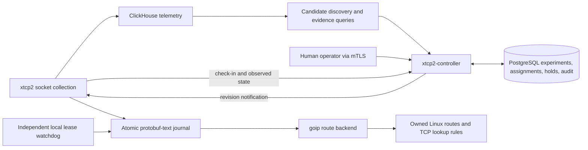

# Reviewed TCP route treatments

xtcp2 can now opt into a separate controller that proposes TCP route treatments,
rolls them out after human review, and withdraws failed trials. Ordinary xtcp2
collection and the goip CLI retain their existing behavior. Route application
requires both `-treatmentConfig` and `enable_apply: true`.

## Components and authority



The implementation lives in [pkg/treatment](../pkg/treatment), with a typed
[protobuf contract](../proto/xtcp/controller/v1/controller.proto). The binaries are:

| Binary | Responsibility |
| --- | --- |
| `xtcp2-controller` | PostgreSQL state, discovery, analysis, review gates, leases, gRPC, status and metrics |
| `xtcp2-controllerctl` | Authenticated `propose`, `analyze`, `review`, `control`, and `inspect` requests |
| `xtcp2` | Optional outbound controller connection, reconciliation and telemetry attribution |
| `xtcp2-treatmentctl` | Local status, suspension, resume, reconciliation, independent watchdog |

ClickHouse is an evidence source; PostgreSQL is the authority for desired state.
Every control mutation commits the experiment, affected assignments and audit
events in one transaction. A transaction-level advisory lock fences replicas.
Request IDs make operator retries idempotent; reusing an ID with a different
request is rejected. Reviews also require the expected experiment revision.
Agents consume complete revisioned snapshots, so missed notifications are safe.
A shared two-second notification scan coalesces updates; jittered check-ins run
approximately every thirty seconds. No message broker is required.

## Supported routes and TCP semantics

The first actuator supports IPv4 `/32` and IPv6 `/128` destinations in the host
network namespace, with ordinary local/main/default routing and a unique simple
unicast baseline route. It refuses policy-routing configurations, VRFs, ECMP,
nexthop objects and unsupported forwarding attributes. Run it on the host, not
inside a private PID/network namespace. Its `/proc/1/ns/net` check detects an
ordinary namespace mismatch; it cannot prove that a container's PID 1 is the
physical host's PID 1.

The default reserved resources are table **10002**, rule priority **30000**, and
route/rule protocol **242**. The actuator copies the baseline gateway, interface,
preferred source and supported metrics into a destination override. TCP rules
with `iif lo` select locally originated traffic. Unmatched traffic falls through
to the normal tables. Main-table routes are never rewritten. These reserved
resources must have one owner; every mutation checks ownership and readback,
and refuses to overwrite or delete a changed/foreign route. Link, address, route
and rule notifications trigger replanning, with periodic reconciliation as a
fallback. A changed forwarding path invalidates the old override.

Settings include congestion algorithm and optional lock, minimum RTO in ms,
initial send/receive windows in segments, quick ACK and ECN. Bounds are enforced
in [validate.go](../pkg/treatment/validate.go). Algorithms must already be loaded.
DCTCP requires explicit ECN and an operator assertion that the fabric has been
independently verified; a low RTT alone does not establish that requirement.
There is no setting to disable TCP slow start.

The nearby-traffic template in
[controller-discovery.json](examples/controller-discovery.json) requests CUBIC,
`rto_min=5ms`, `quickack=1`, `initcwnd=100`, and `initrwnd=100`. These are explicit
route overrides for the discovered destination, including nearby NFS traffic;
they do not depend on matching an application port. The initial windows are in
segments. Discovery preserves these settings in the proposal, and the daemon
persists them in its protobuf-text journal before applying them through goip.
Omitting an optional metric preserves the baseline route's setting. The short
and soak VM tests verify all five installed metrics, including after journal
replay in the short test.

A route treatment is destination-scoped, not socket-scoped, even though socket
data discovers it. Established connections may retain previous TCP settings.
The controller does not call `setsockopt` on application sockets or restart
applications. Withdrawing a route does not immediately undo an algorithm already
selected by a live socket. Long-lived NFS connections can therefore delay an
experiment or make it inconclusive. Initial-window exposure is not inferable
from an established socket's current congestion window. First-release experiments
require a congestion algorithm so the evaluator can observe actual algorithm
exposure; other settings may accompany it, but separate changes are easier to
interpret.

## Experiments and evidence

Candidate templates search per data center, using RTT, retransmission ratio and
optional destination prefixes/ASN filters. RTT/ASN conditions propose a
hypothesis; they do not prove that CUBIC or BBR will help. Existing ASN enrichment
identifies provider mappings, not verified BGP origins. Discovery runs every
thirty minutes with a one-hour lookback and never approves its own proposals.
`-discoveryInterval` (1m..24h) and `-discoveryWindow` (1m..168h) configure these;
discovery is checked on one-minute maintenance ticks. Short windows are useful
for integration testing but change the population and stability of the evidence.
Templates may set `maximum_rtt_increase` as a fractional increase in the range
0..1; omission uses the production default of 0.1 (10%). This policy value is
frozen in each proposal for operator review. The VM soak fixture uses 1.0 to
tolerate small timing variations at 5 ms while testing a jump to 180 ms.
Initially only one proposed,
running or held experiment is allowed per data center.

Each proposal freezes a host population and baseline. Allocation is deterministic
from the experiment ID and interleaved across kernel-version strata. The operator
reviews that population before approving the first host. Eligibility and algorithm
availability are checked again before a newly selected host is assigned.

The default sequence doubles `1, 2, 4, 8, ...`, retains at least two untreated
hosts before the last phase, and then reaches 100% of the **frozen eligible
population**. For eight hosts it is `1, 2, 4, 6, 8`. Newly enrolled hosts do not
silently join an approved experiment. Every expansion and final completion needs
another human review. Minimum observation defaults to thirty minutes **after
verified application**, not merely thirty minutes after sending a command.

| Default policy | Value |
| --- | --- |
| Minimum observation | 30 minutes |
| Maximum phase lifetime | 24 hours |
| Maximum evidence age | 2 minutes |
| Minimum samples per host | 30 sockets and 1 MiB acknowledged |
| Minimum treated hosts for benefit inference | 4 |
| Required lower-bound improvement | 5% |
| Retransmission guardrail | increase of 0.005 in retransmitted/sent byte ratio |
| RTT guardrail | 10% increase in per-host p95 socket RTT |
| Trial lease / renewal interval | 1 hour / 5 minutes |

The first seven values are configurable in the experiment policy. Leases are
currently controller constants. Maintenance runs each minute and may renew the
current cohort with fresh healthy evidence, or roll it back for harm/expiry;
maintenance cannot promote it. A pause stops renewal and promotion, so existing
trial leases eventually expire. Stable assignments have no lease. Completed
experiments receive hourly drift analysis; regressions request operator review
instead of automatically changing approved stable routes.

[analysis.sql](../pkg/treatment/controller/analysis.sql) computes whole-window
counter deltas per boot, host, namespace and socket cookie, deduplicates poll
timestamps, then aggregates per host. It rejects negative endpoint deltas and
collection gaps over thirty seconds. Require normal collection at ten seconds
or faster. This is not a complete exporter-health detector: lost short flows,
resets followed by recovery within the window, and traffic missing altogether
still require external collector-health monitoring.

The host is the experimental unit. Evaluation compares each host's log goodput
change with contemporaneous controls and uses a conservative Welch interval
budgeted over planned phases and minute-level looks. Tiny cohorts are safety
canaries, not evidence of causal benefit. The final 100% phase checks safety after
benefit has been established with controls. RTT/retransmission guardrails protect
both treated and control hosts; insufficient, stale or unexposed data blocks
promotion. Arbitrary repeated operator analyses, adaptive populations, workload
shifts and shared bottlenecks limit statistical interpretation. This is a review
aid, not a guarantee of causality or application-level benefit. Validate NFS/RPC
latency, errors and throughput alongside socket measurements before approval.

Evidence includes analysis/window times, query version, a result digest and
per-host measurements, stored immutably in PostgreSQL. The digest identifies the
query result; the raw ClickHouse response is not archived as an external artifact.
Reviewed phases retain their evidence, reviewer, reason, issue time, observation
start and decision time. New maintenance evidence never overwrites the approved
phase record.

This release uses scheduled whole-window queries against `xtcp_flat_records_v2`.
The existing ingestion materialized view carries the additive attribution fields.
It deliberately does not compute counter deltas in an insert-triggered MV: socket
samples cross insert blocks. A future aggregating-state MV must preserve boundary
samples and deduplication before replacing this query. Benchmark query cost and
end-to-end delivery latency on representative data before enabling many data
centers or approaching 5–10k hosts. The 10k-host notification/cohort tests are not
a production fleet load test.

## PostgreSQL lookup costs and discovery reservations

Discovery first checks the one-active-experiment budget for the data center.
If it is occupied, that template's ClickHouse scan is skipped. Otherwise each
candidate is checked in PostgreSQL by `(location, destination)` before fetching
baseline evidence. PROPOSED, RUNNING, PAUSED, SUSPENDED and COMPLETE experiments
reserve their destinations. RETIRED and ROLLED_BACK experiments reserve them until
24 hours after `updated_at`; at exactly 24 hours they become eligible again.
COMPLETE represents a stable treatment, so it does not expire out of this check.

These checks use experiment state, not a fresh read of every machine's kernel
routes. Desired assignments describe the controller's intent, agent reports
describe verified application, and reconciliation repairs divergence. Drift
monitoring of a completed treatment can request operator review; automatic
discovery does not replace it. An explicit operator proposal may replace a stable
treatment using the existing reviewed predecessor/rollback mechanism.

The early lookup is an optimization. The proposal transaction repeats the
destination check under the existing advisory lock, and repeats the DC budget
check, so concurrent controllers or changes during ClickHouse analysis cannot
insert competing automatic proposals. A database lookup failure stops discovery.

Two B-tree expression indexes support these paths:

| Index | Keys | Purpose |
| --- | --- | --- |
| `xtcp_control_experiments_destination` | location, treatment destination, updated_at descending | Existing-treatment and cooldown lookup without scanning unrelated history. |
| `xtcp_control_experiments_status_location` | experiment status, location | DC budget lookup and status-based maintenance selection. |

The budget query uses `EXISTS` rather than counting every match. The large JSONB
state/evidence document is not indexed wholesale. Agent primary-key and location
indexes already cover their current lookups; no extra heartbeat indexes were
added. An all-agent notification scan still needs to read all agents, so an
additional index alone would not eliminate that work.

`TestPostgresExperimentQueryIndexes` loads 100,000 retired experiments and five
active experiments, runs `ANALYZE`, and compares `EXPLAIN (ANALYZE, BUFFERS)` with
and without these indexes. It checks that PostgreSQL chooses an appropriate
index without disabling sequential scans; execution times are logged, not used
as brittle pass/fail thresholds. Eligibility tables cover all lifecycle states,
cooldown boundaries and location/destination isolation. Concurrent proposal tests
verify that only one automatic proposal is persisted.

On the local PostgreSQL 15.19 fixture, three repeated runs measured a median
25.34 ms without indexes versus 0.023 ms with them for an old destination's
cooldown lookup. These are synthetic query execution times, not end-to-end
production latency. [Raw query-plan timing results](benchmarks/tcp-controller/postgres-indexes.txt)
also include missing destinations and active/idle data-center budget checks.

Startup migration creates missing indexes idempotently. For an existing busy
database, prebuild these indexes before restarting controllers:

```sql
-- Run outside a transaction, using the controller database/schema.
CREATE INDEX CONCURRENTLY IF NOT EXISTS xtcp_control_experiments_destination
  ON xtcp_control_experiments
  (location, (state->'treatment'->>'destination'), updated_at DESC);
CREATE INDEX CONCURRENTLY IF NOT EXISTS xtcp_control_experiments_status_location
  ON xtcp_control_experiments ((state->>'status'), location);
```

Normal index creation blocks writes while building; PostgreSQL's
[concurrent index creation](https://www.postgresql.org/docs/current/sql-createindex.html#SQL-CREATEINDEX-CONCURRENTLY)
avoids that write-blocking build. If a concurrent build fails, inspect and remove
its invalid index before retrying: `IF NOT EXISTS` does not repair an invalid
index. The startup migration uses ordinary index creation, not concurrent DDL.

Further scaling work should measure per-host SQL round trips during review and
lease renewal, large experiment-document rewrites, evidence/audit retention, and
the notification scan. Those need batching or data-layout changes, not blanket
indexes on every field. Discovery currently considers the ten busiest candidate
destinations per template before the PostgreSQL destination filter; pagination
or earlier exclusion would be needed to avoid already-treated destinations
occupying all ten slots.

## Persistence, restart and withdrawal

`/var/lib/xtcp2/routes/state.textproto` is the authoritative atomic snapshot.
`assignment-<id>.textproto` files are readable projections containing receipt,
attempt, application, verification and removal times. Projection files are never
replayed independently. A private directory, file lock, temp-file rename and file
and directory fsync serialize the daemon, watchdog and local commands. Intent is
persisted before kernel mutation; kernel readback precedes success reporting.
Do not hand-edit projections to change desired state.

Startup, periodic work and SIGHUP reconcile the snapshot. Boot IDs prevent stale
kernel fingerprints from being treated as current installations after reboot.
Stable assignments are restored without a controller round trip. Trial expiry is
latched locally: a delayed renewal of the same generation cannot resurrect it.
An explicit approved reactivation increments the generation. A trial replacing a
stable treatment stores a predecessor; expiry/rollback restores that predecessor
when it can be safely replanned. Permanent retirement removes the override.

Run the independent watchdog even when xtcp2 itself stops. It checks every thirty
seconds and withdraws expired trials or persistent holds; it cannot accept new
desired state. Local time synchronization and monitoring of both processes are
required. If both processes are stopped, userspace cannot enforce the lease.
Corrupt journals fail closed for new application and require operator recovery;
they cannot prove ownership of routes already installed.

| Operation | Result |
| --- | --- |
| Experiment `PAUSE` | Freeze promotion and renewal; existing leases run out |
| Experiment/host/DC/fleet `SUSPEND` | Persist a hold and withdraw owned overrides |
| Experiment `RESUME` | Explicitly reactivate the same cohort with a new generation and observation window |
| Host/DC/fleet `RESUME` | Remove that scope's hold; broader and local holds still win |
| Experiment `ROLLBACK` | End the experiment; restore a saved stable predecessor when present |
| Experiment `RETIRE` | End the experiment and remove its overrides |
| Local `suspend` | Offline persistent hold that controller requests cannot clear |

Broad holds are inherited by new enrollments. A narrower resume cannot clear a
broader hold. Expired trials remain latched after a broad hold is lifted; pause
then explicitly resume the experiment, or retire it and propose a new one.
Suspending a completed experiment and resuming it preserves its stable approval.
Withdrawals affect future route/connection behavior; allow existing connections
to turn over before interpreting a temporary baseline test. Disconnected agents
cannot receive an immediate remote hold; use the local command or wait for trial
expiry. Stable routes intentionally persist during controller outages.

Before disabling `enable_apply`, removing `-treatmentConfig`, or uninstalling
the watchdog, suspend the treatments and verify withdrawal. Disabling the
actuator prevents further writes; it does not itself delete existing kernel
routes. Keep the journal through cleanup so ownership can be checked.

## Deployment

1. Build the controller, client, treatmentctl and your normal xtcp2 build flavor.
   Nix exposes `.#xtcp2-controller`, `.#xtcp2-controllerctl` and
   `.#xtcp2-treatmentctl`; all three also build with ordinary `go build`.
2. Provision PostgreSQL with backups and a restricted database identity. The
   controller's `-migrate` applies the additive schema; use it during controlled
   deployment, then remove it from the long-running command. Back up audit and
   evidence tables together. Restoring an older database can yield revisions
   older than daemon journals: stop mutations and reconcile state explicitly;
   do not reset daemon revisions to make the errors disappear.
3. Update the ClickHouse protobuf format schema and apply
   [xtcp_treatment_migration.sql](../build/containers/clickhouse/initdb.d/sql/xtcp_treatment_migration.sql)
   to an existing deployment before enabling agents. Fresh-install DDL already
   contains the new columns. Preserve the telemetry tables and Kafka offsets.
4. Provision mutually authenticated TLS. The controller needs a server DNS SAN;
   agents have exactly one URI SAN `spiffe://xtcp/agent/<location>/<agent-id>`;
   operators have exactly one URI SAN `spiffe://xtcp/operator/<operator-id>`.
   Agent IDs are globally unique and location is certificate-bound. Agent
   certificates cannot invoke operator RPCs or fetch another agent's state.
   Use protected key files; restart processes to load rotated certificates.
   There is no online certificate revocation service in this release.
5. Configure explicit protected prefixes for management, DNS, telemetry,
   controller dependencies and any infrastructure that must not be experimented
   on. The agent also protects controller addresses resolved at startup. DNS
   changes are why configured management prefixes remain necessary.
6. Start the controller near ClickHouse/PostgreSQL, enable agents with application
   disabled first, validate identity/telemetry, then enable the actuator on a
   small test population and deploy the independent watchdog.

Example controller invocation (secrets remain outside the command line):

```sh
xtcp2-controller -listen=:9443 -statusListen=127.0.0.1:9444 \
  -cert=/etc/xtcp2/controller.crt -key=/etc/xtcp2/controller.key \
  -ca=/etc/xtcp2/clients-ca.crt -databaseDSNFile=/etc/xtcp2/postgres.dsn \
  -clickhouse=https://clickhouse.example.net:8443 \
  -discoveryTemplates=/etc/xtcp2/discovery.json
```

ClickHouse credentials use `XTCP_CLICKHOUSE_USER` and
`XTCP_CLICKHOUSE_PASSWORD`. Without `-clickhouse`, analysis and lease renewal are
disabled; manual safety controls remain available. The example
[agent configuration](examples/controller-agent.json) is intentionally disabled;
replace its documentation addresses and protected prefixes before use. The
[discovery templates](examples/controller-discovery.json) are examples of
hypotheses, not recommended network-wide tuning defaults.

On NixOS, set `services.xtcp2.treatments.enable = true`, its `configFile`, and
`watchdogPackage`. The module creates an independent watchdog service. A runtime
JSON file and private keys should remain outside the Nix store. The existing
`systemctl reload xtcp2` sends SIGUSR1 for link-monitor baseline relearning;
use `kill -HUP <xtcp2-pid>` for route reconciliation. Other systems can use the
[example watchdog unit](examples/xtcp2-treatment-watchdog.service).

## Operator workflow

Every CLI request is protobuf text, following the messages in the contract.
Supply `-controller`, `-serverName`, `-cert`, `-key` and `-ca` on each invocation.
Use `-method=inspect` to find proposals and their revisions. Discovery creates
proposals automatically when configured; `-method=propose` accepts a manually
constructed `ProposeRequest` with a complete baseline and policy.

Before approval, refresh and inspect evidence with `-method=analyze`:

```protobuf
experiment_id: "hyp-example"
expected_revision: 1
```

The result is an `AnalyzeResponse` containing `evidence { ... }` and `outcome`.
Copy the evidence block into a `ReviewRequest`, retaining its exact ID and values:

```protobuf
experiment_id: "hyp-example"
expected_revision: 1
approve: true
reason: "Reviewed baseline, eligible hosts and route scope"
request_id: "review-hyp-example-1"
# evidence { ...exact evidence returned by Analyze... }
```

Invoke `-method=review -file=review.textproto`. Subsequent reviews require fresh
evidence covering the observation window. Reuse the same request ID and exact
body after a network timeout; use a new ID for a new decision. Stale revision,
evidence, missing exposure, incomplete host reports or failed guards block review.
An operator may reject a proposal or stop a trial with `approve: false`.

For an emergency fleet hold, use `-method=control` with:

```protobuf
fleet: true
action: CONTROL_ACTION_SUSPEND
reason: "Temporary baseline comparison for incident 123"
request_id: "incident-123-fleet-hold"
```

The same message with a **new** ID and `CONTROL_ACTION_RESUME` lifts that fleet
hold. Substitute exactly one of `location`, `agent_id` or `experiment_id` for
`fleet` to narrow the scope. Offline local withdrawal:

```sh
xtcp2-treatmentctl -config=/etc/xtcp2/controller-agent.json \
  -mode=suspend -reason='Local baseline comparison for incident 123'
xtcp2-treatmentctl -config=/etc/xtcp2/controller-agent.json -mode=status
xtcp2-treatmentctl -config=/etc/xtcp2/controller-agent.json \
  -mode=resume -reason='Comparison finished'
```

The optional status listener provides operator-mTLS-protected `/readyz`, `/status`
and `/metrics`. Monitor controller/agent availability, failed and expired route
records, holds, growing pending experiments, evidence freshness and watchdog
logs. `/status` is a JSON dashboard feed, not a graphical UI. A stopped controller
does not disable the ordinary xtcp2 collection service.

## Validation and remaining extensions

See the [test and benchmark audit](tcp-controller-testing.md) for table-driven
contracts, race coverage, measured performance, coverage limits, and reproducible
Nix unit/race/benchmark targets with isolated PostgreSQL and ClickHouse fixtures.

Tests cover durable intent/crash recovery, stale generations, predecessor expiry,
local/broad holds, concurrent controller reviews, full human-reviewed rollout,
early safety withdrawal, actual algorithm attribution, and 10k-host cohort and
notification behavior. Optional tests exercise real PostgreSQL, ClickHouse SQL,
and IPv4/IPv6 netlink mutation in a disposable namespace:

```sh
go test ./pkg/treatment/... ./internal/goip/...
XTCP_CONTROLLER_TEST_DSN='host=... dbname=... user=... sslmode=...' \
  go test ./pkg/treatment/controller -run Postgres
XTCP_CLICKHOUSE_TEST_BINARY=/path/to/clickhouse \
  go test ./pkg/treatment/controller -run ClickHouse
XTCP_TREATMENT_LIVE_TEST=1 go test ./internal/goip -run '^TestTreatmentLiveNamespace$'
```

The PostgreSQL tests create and drop only unique test schemas. The route test
creates its own user/network namespace and verifies that it differs from the
parent namespace before any write. It requires `ip`, `unshare` and a kernel that
permits unprivileged user namespaces. Existing daemon tests need this repository's
`-ldflags=-checklinkname=0` flag for giouring.

The [Go-driven controller VM integration test](integration-testing.md#tcp-controller-integration)
uses the existing TCP load tools, six agent guests, real PostgreSQL/ClickHouse,
and `tc netem` latency bands. Run `nix run path:.#test-tcp-controller-vm`;
the cached target is `checks.x86_64-linux.vm-tcp-controller`. It checks reviewed
1→2 canaries, actual socket algorithm exposure, restart persistence, holds,
automatic rollback after injected harm, and independent watchdog lease expiry.
The longer `test-tcp-controller-soak-vm` target varies RTT every three minutes,
checks repeated scheduled discovery and automatic rollback, and verifies the
destination cooldown. Its test operator explicitly approves each new canary.

Future work includes application SLO inputs, richer workload/fabric stratification,
aggregated analytical storage, provider-feed provenance, enrollment reconciliation
for new hosts, multi-experiment scheduling, automated withdrawal experiments,
and a graphical review dashboard. A future automated/LLM reviewer can consume the
same typed evidence and decision interface, but the deterministic authorization,
ownership, budget, freshness and guardrail checks must remain mandatory. This
release does not autonomously promote treatments or claim that a successful
small test has optimized an entire production fleet.
